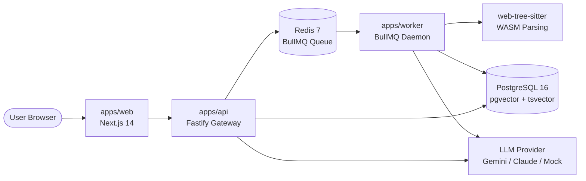

# RepoMentor 🧠

> **Turn any GitHub repository into an interactive, grounded, and persistent onboarding workspace in seconds.**

[](https://github.com/your-org/repomentor/actions/workflows/ci.yml)
[](https://opensource.org/licenses/Apache-2.0)
[](file:///CONTRIBUTING.md)
[](https://www.typescriptlang.org/)
[](https://nodejs.org/)

---

## 💡 Why RepoMentor Exists

When a software engineer, open-source contributor, or engineering manager joins an unfamiliar codebase, they often face thousands of lines of undocumented code, opaque directory conventions, and fragmented setup scripts. 

RepoMentor eliminates this learning curve:
1. **Instant Onboarding Report**: Generates an exhaustive 7-section guide: project rationale, tech stack justifications, architecture flowcharts, folder structures, local setup commands, and key files to read first.
2. **AST-Aware Hybrid RAG**: Parses syntax at the function, class, and interface level using WebAssembly (`web-tree-sitter`). Retrieves code via dual dense vectors + sparse lexical search (RRF $k=60$) and answers questions with verifiable line citations.
3. **3-Layer Persistent Memory**: Tracks your active goals, comprehension state, and preferences across sessions.
4. **Enhancement Assistant**: Turns feature requests or bug descriptions into step-by-step plans with impact analysis and unified diffs.

---

## 📸 Demo & Interface

```text
┌────────────────────────────────────────────────────────────────────────────┐
│  RepoMentor  /  facebook/react                                             │
├────────────────────────────────────────────────────────────────────────────┤
│  [Onboarding Report]    [RAG Code Chat]    [Memory State]    [Enhancement] │
├────────────────────────────────────────────────────────────────────────────┤
│  RM: "useState() resolves via resolveDispatcher() in the fiber reconciler" │
│      Citation: [packages/react/src/ReactHooks.js:25-32]                    │
│      ┌────────────────────────────────────────────────────────────────┐    │
│      │ 25 | export function useState(initialState) {                  │    │
│      │ 26 |   const dispatcher = resolveDispatcher();                 │    │
│      │ 27 |   return dispatcher.useState(initialState);               │    │
│      │ 28 | }                                                         │    │
│      └────────────────────────────────────────────────────────────────┘    │
└────────────────────────────────────────────────────────────────────────────┘
```

---

## ⚡ Quickstart (Run Locally in <10 Minutes)

Run with **Zero Paid Keys** using the **Free Google Gemini API** or **100% Offline Mock Mode**.

### 1. Clone & Configure
```bash
git clone https://github.com/your-org/repomentor.git
cd repomentor
cp .env.example .env
```

*(Optional: Add your free Google Gemini API key to `.env` as `GEMINI_API_KEY=AIzaSy...`, or leave as mock mode).*

### 2. Boot Infrastructure & Monorepo
```bash
# Start PostgreSQL (with pgvector) and Redis in Docker
pnpm docker:up

# Install dependencies and apply database migrations
pnpm install
pnpm --filter @repomentor/db db:migrate

# Start full dev stack (Web: 3000, API: 4000, Worker daemon)
pnpm dev
```

Visit **[http://localhost:3000](http://localhost:3000)** and paste any public GitHub repository URL!

---

## 🛠️ Technology Stack

| Layer | Technology | Purpose |
| :--- | :--- | :--- |
| **Frontend** | Next.js 14 (App Router) + Tailwind + shadcn/ui | Reactive workspace UI & streaming SSE renderer |
| **State & Cache** | TanStack Query (v5) | Client-side cache synchronization & optimistic updates |
| **API Gateway** | Fastify 4 + Zod + Swagger OpenAPI | High-throughput async REST server with type validation |
| **Database** | PostgreSQL 16 + `pgvector` extension | Relational tables & HNSW vector cosine similarity search |
| **ORM & Migrations**| Drizzle ORM + drizzle-kit | Type-safe SQL-like queries & forward-only migrations |
| **Job Queue** | BullMQ 5 + Redis 7 | Resilient background processing for repo ingestion |
| **AST Parser** | `web-tree-sitter` (WASM) | Multi-language syntax parsing without native compilers |
| **LLM Providers** | Google Gemini (Free tier default) / Claude 3.5 | Architecture synthesis, RAG streaming, and memory |
| **Embeddings** | Voyage AI / Mock Offline Provider | 1536-dimensional code embeddings |

---

## 🏗️ Architecture at a Glance



---

## 📂 Repository Structure

```text
repomentor/
├── apps/
│   ├── api/          # Fastify REST API, Swagger docs, SSE streaming routes
│   ├── web/          # Next.js App Router UI, interactive chat, code drawer
│   └── worker/       # BullMQ background job processor for shallow clones & indexing
├── packages/
│   ├── core/         # Pure domain logic: AST chunking, hybrid RAG, memory, LLM
│   ├── db/           # PostgreSQL schema, migrations, Drizzle ORM repositories
│   ├── prompts/      # Versioned, type-safe LLM prompt templates
│   └── shared/       # Zod validation schemas, TypeScript interfaces, error classes
├── docs/             # Architecture, data model, RAG & memory, API, ADRs
└── .agent/           # AI coding agent rules and developer workflows
```

---

## 🧪 Testing & Verification

```bash
# Run all unit and integration test suites
pnpm test

# Run strict TypeScript typecheck
pnpm typecheck

# Verify linter and code formatting
pnpm lint && pnpm format:check
```

---

## 🤝 Contributing & Community

Contributions are warmly welcomed! We have pre-configured issues and well-scoped areas ready to tackle:
- Read our [Contribution Guide (`CONTRIBUTING.md`)](file:///CONTRIBUTING.md) for starter issues, domain areas, branching, Conventional Commits, and PR checklists.
- Review our [Project Governance (`GOVERNANCE.md`)](file:///GOVERNANCE.md) and [Code of Conduct (`CODE_OF_CONDUCT.md`)](file:///CODE_OF_CONDUCT.md).

For broader milestones and future capabilities, see the [Product Roadmap (`docs/roadmap.md`)](file:///docs/roadmap.md).

---

## 🛡️ Security

RepoMentor treats all analyzed repositories as untrusted data. We enforce zero host execution, WASM sandboxing, SSRF guards, and CDATA delimiter prompt-injection defenses. See [`SECURITY.md`](file:///SECURITY.md) for vulnerability disclosure.

---

## 📄 License

Licensed under the [Apache License 2.0](file:///LICENSE).
