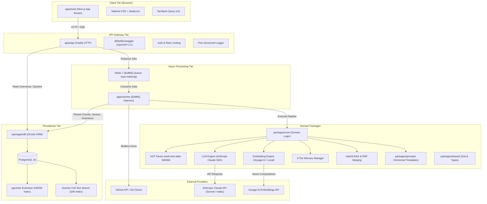
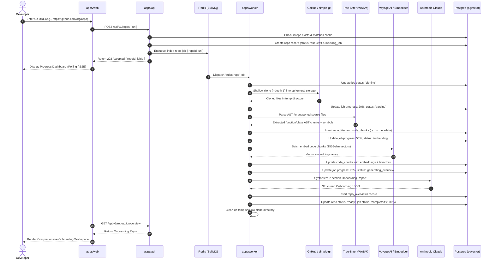
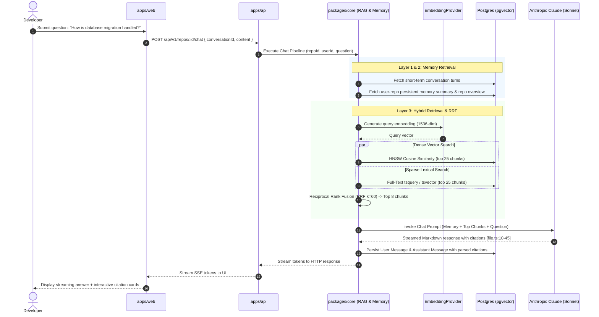

# System Architecture - RepoMentor

---

## 1. System Overview

RepoMentor is engineered as an event-driven, decoupled system composed of a modern reactive frontend, a high-throughput HTTP API, a distributed asynchronous background worker cluster, and a unified storage engine powered by PostgreSQL 16 with the `pgvector` extension and Redis.

### Architectural Tenets:
1. **Asynchronous Ingestion**: Repository ingestion is fundamentally long-running (cloning, AST parsing, embedding, synthesizing reports). It is decoupled from the HTTP cycle via BullMQ queues.
2. **Layer Inversion & Framework Agnosticism**: Core domain models, retrieval math, AST parsers, and prompt definitions reside in pure TypeScript packages independent of web frameworks.
3. **Defense-in-Depth**: Cloned code is treated as malicious input. AST parsing runs inside sandboxed WebAssembly runtimes (`web-tree-sitter`).
4. **Hybrid Code Retrieval**: Code search merges dense semantic embeddings with sparse full-text keyword indices using Reciprocal Rank Fusion (RRF).

---

## 2. High-Level Component Diagram

---

## 3. End-to-End Data Flow 1: "Index a Repository"

The sequence diagram below illustrates the complete lifecycle of indexing a repository:

---

## 4. End-to-End Data Flow 2: "Ask a Question (RAG with Citations)"

---

## 5. Scalability & High Availability Architecture

1. **Horizontally Scalable Stateless Workers**:
   - Worker processes (`apps/worker`) run independently in stateless Docker containers.
   - Worker concurrency is dynamically managed through BullMQ worker pool sizing and Redis queue backlog metrics.
2. **PostgreSQL Connection Optimization**:
   - Fastify API instances and BullMQ workers connect to PostgreSQL using a connection pool configured with max connections and idle timeouts via `pg.Pool`.
3. **Rate Limiting & Cost Management**:
   - Ingestion jobs are rate-limited per user and per IP.
   - Voyage AI batch embedding requests are grouped into maximum permissible batch payloads (e.g., 128 chunks per call) to minimize network roundtrips.
4. **Storage Pruning & Ephemeral Workspace Hygiene**:
   - Git repository clones are stored strictly in temporary, auto-deleted directories (`tmp/repomentor/<job_id>`).
   - If a worker crashes mid-clone, cleanup hooks clean orphan directories on boot.

