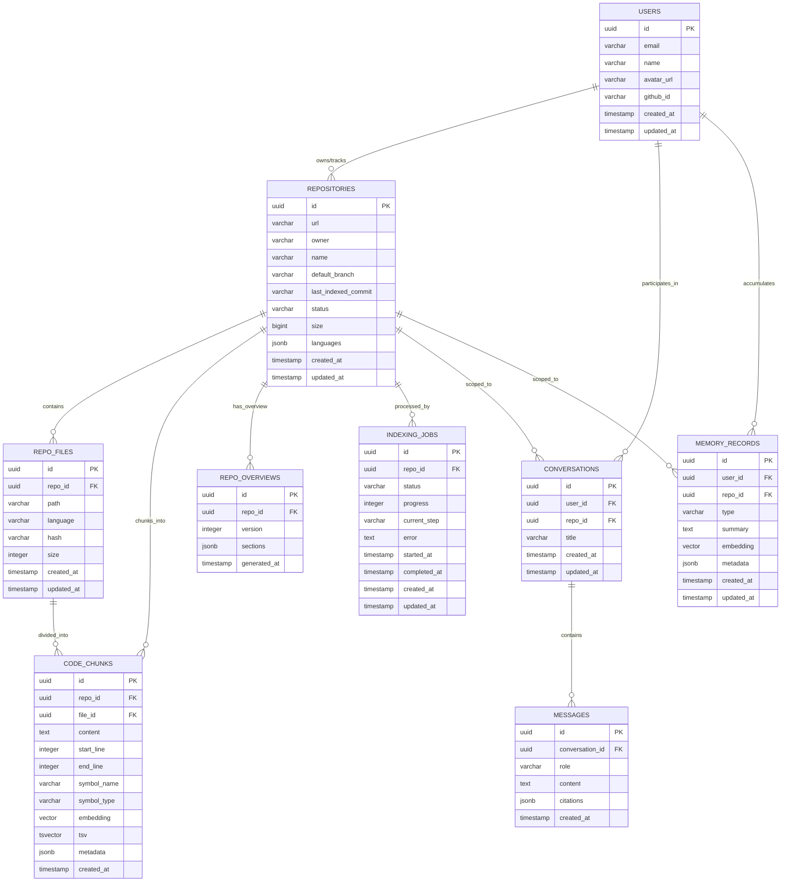

# Data Model & Storage Architecture - RepoMentor

---

## 1. Overview & Database Philosophy

RepoMentor uses **PostgreSQL 16** with the **`pgvector`** extension as its single source of truth for relational entities, vector embeddings, and full-text search indexes.

### Key Architectural Advantages:
1. **Zero Multi-Database Overhead**: Avoids dual-database synchronization issues (e.g., Pinecone/Milvus + PostgreSQL). Relational integrity and vector similarity coexist in the same ACID transactions.
2. **Hybrid Search in a Single Query**: Performs vector similarity search ($L_2$ or Cosine) and full-text keyword matching (`tsvector`) within the same database engine.
3. **Robust Migrations**: Managed via Drizzle ORM and `drizzle-kit`, providing declarative TypeScript schema definitions and version-controlled SQL migrations.

---

## 2. Entity-Relationship (ER) Diagram



---

## 3. Table Schema & Column Definitions

### 3.1 `users`
Tracks registered developers and authenticated GitHub accounts.
- `id` (`UUID`, Primary Key, default `gen_random_uuid()`): Unique identifier.
- `email` (`VARCHAR(255)`, Unique, Nullable): User's primary email.
- `name` (`VARCHAR(255)`, Nullable): Display name.
- `avatar_url` (`TEXT`, Nullable): Profile picture link.
- `github_id` (`VARCHAR(100)`, Unique, Nullable): GitHub OAuth account identifier.
- `created_at` (`TIMESTAMPTZ`, default `NOW()`): Record creation timestamp.
- `updated_at` (`TIMESTAMPTZ`, default `NOW()`): Last update timestamp.

### 3.2 `repositories`
Metadata for analyzed Git repositories.
- `id` (`UUID`, Primary Key, default `gen_random_uuid()`): Unique repository ID.
- `url` (`TEXT`, Not Null, Unique): Canonical Git clone URL (e.g., `https://github.com/facebook/react`).
- `owner` (`VARCHAR(255)`, Not Null): Organization or user name.
- `name` (`VARCHAR(255)`, Not Null): Repository name.
- `default_branch` (`VARCHAR(100)`, Not Null, default `'main'`): Head branch analyzed.
- `last_indexed_commit` (`VARCHAR(40)`, Nullable): SHA-1 hash of the indexed commit.
- `status` (`VARCHAR(50)`, Not Null, default `'queued'`): Status lifecycle: `'queued'`, `'cloning'`, `'parsing'`, `'indexing'`, `'ready'`, `'failed'`.
- `size` (`BIGINT`, Nullable): Total repository size in bytes.
- `languages` (`JSONB`, default `'{}'`): Breakdown of detected programming languages and byte distributions.
- `created_at` / `updated_at` (`TIMESTAMPTZ`, default `NOW()`).

### 3.3 `repo_files`
Catalog of analyzed source files within each repository.
- `id` (`UUID`, Primary Key, default `gen_random_uuid()`).
- `repo_id` (`UUID`, Foreign Key references `repositories(id)` on delete cascade).
- `path` (`TEXT`, Not Null): Relative POSIX file path (e.g., `src/core/parser.ts`).
- `language` (`VARCHAR(50)`, Not Null): Identified language (`typescript`, `python`, `go`).
- `hash` (`VARCHAR(64)`, Not Null): SHA-256 hash of file content to detect file-level drift.
- `size` (`INTEGER`, Not Null): File size in bytes.
- `created_at` / `updated_at` (`TIMESTAMPTZ`, default `NOW()`).

### 3.4 `code_chunks`
Atomic AST-parsed code snippets with vector embeddings and full-text search indexes.
- `id` (`UUID`, Primary Key, default `gen_random_uuid()`).
- `repo_id` (`UUID`, Foreign Key references `repositories(id)` on delete cascade).
- `file_id` (`UUID`, Foreign Key references `repo_files(id)` on delete cascade).
- `content` (`TEXT`, Not Null): The verbatim source code of the chunk.
- `start_line` (`INTEGER`, Not Null): 1-based start line number.
- `end_line` (`INTEGER`, Not Null): 1-based end line number.
- `symbol_name` (`VARCHAR(255)`, Nullable): Function, class, or interface name (e.g., `calculateHash`).
- `symbol_type` (`VARCHAR(50)`, Nullable): Symbol classification (`function`, `method`, `class`, `interface`, `module`).
- `embedding` (`vector(1536)`, Nullable): Semantic embedding vector generated by Voyage AI.
- `tsv` (`tsvector`, Nullable): Full-text lexical search vector for hybrid search.
- `metadata` (`JSONB`, default `'{}'`): Additional context (parent class name, imports, docstrings).
- `created_at` (`TIMESTAMPTZ`, default `NOW()`).

### 3.5 `repo_overviews`
Generated 7-part contributor onboarding guides for repositories.
- `id` (`UUID`, Primary Key, default `gen_random_uuid()`).
- `repo_id` (`UUID`, Foreign Key references `repositories(id)` on delete cascade).
- `version` (`INTEGER`, Not Null, default `1`): Monotonically increasing overview version.
- `sections` (`JSONB`, Not Null): Structured JSON adhering to `RepoOverviewSectionsSchema`:
  - `summary`: One-paragraph executive overview.
  - `purpose`: Why the project exists and core problems it solves.
  - `tech_stack`: Primary runtime, libraries, frameworks, tools with justifications.
  - `architecture`: Conceptual architecture, data flow description, Mermaid diagrams.
  - `folder_structure`: Annotated directory tree detailing module responsibilities.
  - `setup_guide`: Step-by-step local prerequisites, environment configs, and dev commands.
  - `key_files`: Curated list of high-impact files for newcomers to read first.
  - `contribution_workflow`: PR rules, testing instructions, commit conventions.
- `generated_at` (`TIMESTAMPTZ`, default `NOW()`).

### 3.6 `conversations`
Chat sessions between a user and a repository knowledge base.
- `id` (`UUID`, Primary Key, default `gen_random_uuid()`).
- `user_id` (`UUID`, Nullable, Foreign Key references `users(id)` on delete cascade).
- `repo_id` (`UUID`, Foreign Key references `repositories(id)` on delete cascade).
- `title` (`VARCHAR(255)`, Not Null, default `'New Conversation'`): Generated conversation title.
- `created_at` / `updated_at` (`TIMESTAMPTZ`, default `NOW()`).

### 3.7 `messages`
Individual dialog turns within a conversation.
- `id` (`UUID`, Primary Key, default `gen_random_uuid()`).
- `conversation_id` (`UUID`, Foreign Key references `conversations(id)` on delete cascade).
- `role` (`VARCHAR(20)`, Not Null): `'user'` | `'assistant'` | `'system'`.
- `content` (`TEXT`, Not Null): Message text in Markdown format.
- `citations` (`JSONB`, default `'[]'`): Array of citation objects:
  `[{ file_path: string, start_line: number, end_line: number, snippet: string }]`.
- `created_at` (`TIMESTAMPTZ`, default `NOW()`).

### 3.8 `memory_records`
Persistent episodic and semantic memory scoped to a `(user, repo)` pair.
- `id` (`UUID`, Primary Key, default `gen_random_uuid()`).
- `user_id` (`UUID`, Nullable, Foreign Key references `users(id)` on delete cascade).
- `repo_id` (`UUID`, Foreign Key references `repositories(id)` on delete cascade).
- `type` (`VARCHAR(50)`, Not Null): Memory tier: `'short_term'`, `'repo_state'`, `'long_term_summary'`, `'preference'`.
- `summary` (`TEXT`, Not Null): Synthesized natural language summary of user knowledge and prior goals.
- `embedding` (`vector(1536)`, Nullable): Semantic embedding of memory summary for associative recall.
- `metadata` (`JSONB`, default `'{}'`): Source turn references and compression statistics.
- `created_at` / `updated_at` (`TIMESTAMPTZ`, default `NOW()`).

### 3.9 `indexing_jobs`
Lifecycle tracking for asynchronous BullMQ repository indexing jobs.
- `id` (`UUID`, Primary Key, default `gen_random_uuid()`).
- `repo_id` (`UUID`, Foreign Key references `repositories(id)` on delete cascade).
- `status` (`VARCHAR(50)`, Not Null, default `'pending'`): `'pending'`, `'active'`, `'completed'`, `'failed'`.
- `progress` (`INTEGER`, Not Null, default `0`): 0 to 100 percentage indicator.
- `current_step` (`VARCHAR(100)`, Nullable): `'cloning'`, `'parsing_ast'`, `'generating_embeddings'`, `'synthesizing_overview'`.
- `error` (`TEXT`, Nullable): Detailed stack trace or error message upon failure.
- `started_at` / `completed_at` (`TIMESTAMPTZ`, Nullable).
- `created_at` / `updated_at` (`TIMESTAMPTZ`, default `NOW()`).

---

## 4. Database Indexing Strategy

To guarantee millisecond latency at scale:
1. **HNSW Vector Index**:
   ```sql
   CREATE INDEX idx_code_chunks_embedding_hnsw 
   ON code_chunks 
   USING hnsw (embedding vector_cosine_ops)
   WITH (m = 16, ef_construction = 64);
   ```
2. **GIN Full-Text Search Index**:
   ```sql
   CREATE INDEX idx_code_chunks_tsv 
   ON code_chunks 
   USING gin (tsv);
   ```
3. **Compound Foreign Key & Lookup Indexes**:
   - `idx_code_chunks_repo_file`: `code_chunks(repo_id, file_id)`
   - `idx_repo_files_repo_path`: `repo_files(repo_id, path)`
   - `idx_conversations_user_repo`: `conversations(user_id, repo_id)`
   - `idx_memory_records_user_repo`: `memory_records(user_id, repo_id, type)`

