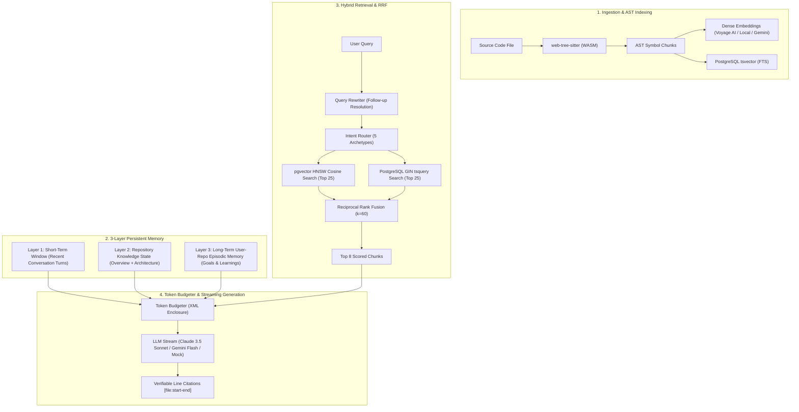

# Hybrid Code RAG & 3-Tier Memory Architecture - RepoMentor

---

## 1. Executive Overview

Source code question-answering fails when built with naive document-RAG architectures. Arbitrary character-window chunking cuts functions in half, breaks syntax boundaries, divorces methods from their enclosing classes, and causes catastrophic context amnesia across conversation sessions.

RepoMentor solves this by uniting an **AST-Aware Hybrid Retrieval Pipeline** with a **3-Layer Persistent Memory Architecture** scoped per `(user, repo)` tuple.



---

## 2. AST-Aware Code Chunking via `web-tree-sitter`

Rather than line-count or character-window chunking, RepoMentor parses source code abstract syntax trees using WebAssembly grammars (`web-tree-sitter`).

### 2.1 Supported Syntax Nodes & Symbol Extraction
Universal AST symbol extractors (`UniversalSymbolExtractor` in `packages/core/src/chunking/ast-symbol-extractor.ts`) extract atomic semantic units across 7 languages:

| Language | Extracted Symbol Types | Tree-Sitter Node Kinds |
| :--- | :--- | :--- |
| **TypeScript / JS** | Functions, Classes, Methods, Type Aliases, Interfaces | `function_declaration`, `method_definition`, `class_declaration`, `interface_declaration` |
| **Python** | Functions, Async Functions, Classes, Decorated Methods | `function_definition`, `class_definition`, `decorated_definition` |
| **Go** | Functions, Methods, Struct Types, Interface Types | `function_declaration`, `method_declaration`, `type_spec` |
| **Rust** | Functions, Structs, Enums, Impl Blocks, Traits | `function_item`, `struct_item`, `enum_item`, `impl_item`, `trait_item` |
| **Java** | Classes, Interfaces, Constructors, Methods | `class_declaration`, `interface_declaration`, `method_declaration` |
| **C / C++** | Functions, Structs, Classes, Namespaces | `function_definition`, `struct_specifier`, `class_specifier` |
| **Markdown / Docs**| Heading-aware sections (H1-H4) | Heading-aware splitter (`markdown-chunker.ts`) |

### 2.2 Hierarchical Chunking Invariants
1. **Target Chunk Size**: 300 to 800 tokens (`minChunkTokens: 50`, `maxChunkTokens: 800`).
2. **Atomic Invariance**: Standalone functions or methods under 800 tokens are never split.
3. **Oversized Symbols (>1,200 tokens)**: When a monolithic class or huge function exceeds the maximum chunk size, the chunker splits along child AST boundaries (e.g., individual methods within the class).
4. **Context Header Preservation**: Every child chunk inherits the parent symbol declaration as a header comment:
   ```typescript
   // Context: class IngestionPipeline extends BasePipeline
   // Method: async processFile(filePath: string)
   ```

---

## 3. Hybrid Retrieval & Reciprocal Rank Fusion (RRF)

### 3.1 Why Hybrid Search is Mandatory for Code
- **Dense Vector Search (Cosine Similarity)** excels at semantic queries where the user does not know the exact variable name (e.g., *"how are session cookies encrypted?"*).
- **Sparse Full-Text Search (PostgreSQL `tsvector` + GIN)** excels at exact symbol matches, specific identifiers, route paths, and error codes (e.g., `TOKEN_EXPIRED`, `/api/v1/auth/callback`, `JWT_SECRET`).

### 3.2 Reciprocal Rank Fusion (RRF) Formula
RRF merges the ranked lists from both search engines without requiring score normalization across different scales:

$$RRF\_Score(d) = \sum_{m \in \{\text{dense}, \text{sparse}\}} \frac{1}{k + r_m(d)}$$

Where:
- $r_m(d)$ is the 1-based rank of document $d$ in search system $m$.
- $k$ is the smoothing constant calibrated to **60** (industry standard).

Implemented in `packages/core/src/rag/hybrid-retriever.ts` and validated in `packages/core/tests/rrf.test.ts`.

---

## 4. Query Rewriting & Question-Type Intent Routing

### 4.1 Standalone Query Rewriting
When a user asks a follow-up question containing pronouns or implicit references (e.g., *"Can you show me where that is called?"* or *"How do I test it?"*), the `QueryRewriter` (`packages/core/src/rag/query-rewriter.ts`) inspects the recent conversation history to reformulate the user prompt into an unambiguous standalone search query before running vector and full-text retrieval.

### 4.2 Intent Routing Archetypes
Incoming questions are categorized by `classifyQuestionIntent` (`packages/core/src/rag/intent-router.ts`) into 5 archetypes:
1. `explain_code`: Focuses on algorithmic structure, control flow, and data transformations.
2. `how_to_run`: Focuses on CLI commands, package scripts, docker setup, and local environment variables.
3. `where_is_implemented`: Targets file paths, line ranges, and caller/callee relationships.
4. `add_feature`: Provides grounded implementation suggestions with impact analysis and unified diffs.
5. `general`: Broad architectural context and repository navigation.

---

## 5. The 3-Layer Memory Architecture

RepoMentor avoids "session amnesia" by maintaining a 3-layer persistent memory hierarchy per `(user, repo)`:

```mermaid
flowchart TD
    subgraph MemoryLayers["Memory Hierarchy"]
        L1["Layer 1: Short-Term Window (Last 6-10 Conversation Turns)"]
        L2["Layer 2: Repository Knowledge State (Overview + Architecture)"]
        L3["Layer 3: Long-Term Episodic Memory (Goals, Comprehension, Preferences)"]
    end

    subgraph Assembly["Token Budget Allocator"]
        L1 --> Assembly
        L2 --> Assembly
        L3 --> Assembly
        RAG["Retrieved Code Chunks (pgvector + FTS)"] --> Assembly
        UserQuery["Current User Message"] --> Assembly
    end

    Assembly --> Prompt["Final Hydrated XML Prompt"]
```

### Layer 1: Short-Term Working Window (Ephemeral)
- **Scope**: Current active conversation session (`messages` table).
- **Content**: Verbatim dialog history of the last 6 to 10 turns.
- **Budget**: 4,000 tokens. Oldest turns are trimmed first when context limit is approached.

### Layer 2: Repository Knowledge State (Semi-Static)
- **Scope**: Entire repository, shared across all users viewing that commit (`repo_overviews` table).
- **Content**: Synthesized 7-section Onboarding Report: Purpose, Tech Stack justifications, Architecture with Mermaid, Setup Guide, and Key Files reading order.
- **Budget**: 3,000 tokens.

### Layer 3: Long-Term User-Repo Episodic Memory (Persistent)
- **Scope**: Unique to each `(user_id, repo_id)` pair (`memory_records` table).
- **Content**: Distilled markdown summary tracking:
  1. **Active Goal & Focus**: What feature or bug the user is actively working on.
  2. **Comprehension State**: What patterns the user understands vs. concepts requiring explanation.
  3. **Traversed Files**: Which files the user has already analyzed or modified.
  4. **Developer Preferences**: Coding style preferences (e.g., explicit typing, functional patterns).
- **Update Trigger**: Extracted automatically every $N$ turns or at conversation close via `MemorySummarizer` (`packages/core/src/memory/memory-summarizer.ts`).

---

## 6. Token Budget Allocation & Trimming Priority

To fit safely within LLM context windows, `TokenBudgeter` (`packages/core/src/memory/token-budgeter.ts`) enforces strict token caps:

| Priority | Prompt Section | Token Budget | Trimming Strategy |
| :---: | :--- | :--- | :--- |
| **1** | System Instructions | 1,500 tokens | **Never trimmed** (hard invariants) |
| **2** | Current User Query | 1,000 tokens | **Never trimmed** |
| **3** | Repository Overview | 3,000 tokens | Cached summary, compact representation |
| **4** | Long-Term User Memory | 1,500 tokens | Markdown bullets; trimmed to most recent goal |
| **5** | Retrieved Code Chunks | 12,000 tokens | Packed by RRF score; lowest scoring chunks dropped first |
| **6** | Short-Term Conversation | 4,000 tokens | Packed most-recent first; oldest turns dropped |
| **--** | Completion Reserved | 4,000 tokens | Output reservation for model response |
| **Total** | **Full Context Budget** | **28,000 tokens** | Safe for Claude 3.5 Sonnet, Gemini Flash, or local models |

---

## 7. Verifiable Citations & Hallucination Defense

RepoMentor enforces verifiable citations for all assertions:
1. **Citation Format**: Every claim grounded in code must cite `[filePath:startLine-endLine]`.
2. **Citation Parser (`citation-parser.ts`)**: RegEx validation extracts citation tuples and matches them against the retrieved code boundaries.
3. **Interactive UI Drawer (`code-viewer.tsx`)**: Clicking an inline citation badge displays the exact lines with syntax highlighting and a direct link to GitHub.
4. **"Not Found in Code" Behavior**: If retrieved chunks lack sufficient evidence, system instructions strictly require the model to state that the information was not found in the codebase rather than hallucinating.

